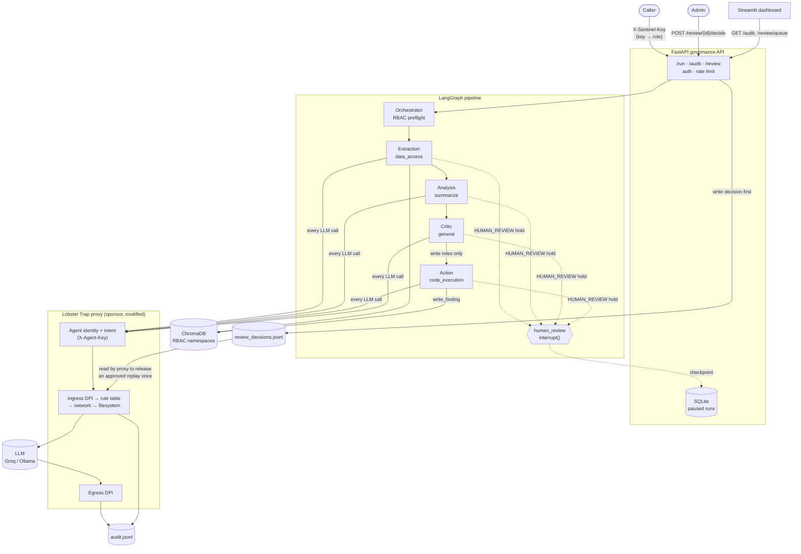

# SentinelMesh Architecture

## Diagram

## 1. Governance proxy (Lobster Trap)

Lobster Trap is the hackathon sponsor's Deep Prompt Inspection proxy, which this project builds on and modifies (see the README for the list of changes). It sits between the agents and the LLM (Groq or Ollama).

- **Latency grows with prompt length.** Regex DPI takes about 0.1–0.2 ms p50 for short prompts and 3.0 ms p50 for a 4 KB document on an Apple M4 (see [threat-model.md](threat-model.md#performance-cost-of-inspection)).
- **Agent identity binding.** Each agent authenticates with its own key (`X-Agent-Key`). The proxy denies unknown agents, mismatched keys, and intents an agent isn't registered for (`agents:` in `proxy/policy.yaml`).
- **Intent mismatch.** Agents declare an intent and Lobster Trap classifies the actual intent with keyword patterns. A `summarize` declaration that DPI classifies as a non-general intent triggers `HUMAN_REVIEW`.
- **Risk scoring.** Every prompt and response gets a risk score. Scores above 0.8 are quarantined.
- **Three-layer enforcement in `ProcessIngress`:**
  1. Match-action rule table (`ingress_rules` in `proxy/policy.yaml`), first match wins, evaluated by priority.
  2. Network policy (`network.denied_domains`, `network.allowed_domains`), checked if the rule table returns ALLOW or LOG.
  3. Filesystem policy (`filesystem.denied_paths`), checked after network, with `**` recursive globs.
- **Egress inspection.** Model output is buffered and inspected before delivery. Streaming is denied, and a response the proxy can't decode or parse is denied (`egress_uninspectable`) rather than forwarded.
- **Strict policy loading.** Unknown keys, fields, match types, bad regexes and unimplemented actions are load errors, not silent no-ops.

## 2. Multi-agent orchestration (LangGraph)

A `StateGraph` runs the pipeline:

1. **Orchestrator** validates the caller's role and namespace before any LLM call.
2. **Extraction agent** retrieves context from ChromaDB.
3. **Analysis agent** summarizes and classifies.
4. **Critic agent** reviews the output for compliance and quality.
5. **Action agent** proposes one JSON tool call (`write_finding` into the `findings` namespace, or `notify`), validated with Pydantic and re-checked against RBAC before it runs. Only roles with `can_write` reach it.

Any LLM step that the proxy holds for review routes to `human_review_node`, which pauses the run.

All LLM steps share `_run_llm_step`, which detects proxy blocks (`[SENTINEL]` / `[LOBSTER TRAP]` content) and review holds (`_lobstertrap.verdict`).

## 3. RBAC and data privacy

- **Namespaced vector store.** `NamespacedVectorStore` checks the role before every ChromaDB query or upsert. An analyst can't query `hr`.
- **Write guards.** `assert_write_access` runs before any state-changing action.

## 4. Visibility and governance

- **Audit.** The Streamlit dashboard reads `GET /audit?limit=1000` (the API tails the JSONL log with bounded memory) and auto-refreshes. The proxy's own dashboard at `http://localhost:8080/_lobstertrap/` streams events live over WebSocket.
- **Human in the loop.** A HUMAN_REVIEW verdict pauses the LangGraph run (`interrupt()` plus a SQLite checkpointer on the `api_data` volume, so paused runs survive an API restart for up to 24 h). An admin decision is written to `review_decisions.jsonl` first, then the run resumes. Approve replays the held call with `X-Sentinel-Review-Approved`, which the proxy honours once, for the same agent, intent and byte-identical body, only if the first decision is an approval made after the hold and within 15 minutes. Reject ends the run as blocked.
- **Log rotation.** `POST /audit/rotate` (admin only) copies `audit.jsonl` and `review_decisions.jsonl` to timestamped archives, then truncates the originals in place. History is archived, never deleted. It copies and truncates instead of renaming because the Go proxy holds the audit file open with `O_APPEND`, so a rename would send its writes into the archive. Rotation is refused (409) while runs are paused. Rotate when idle: a proxy write that lands between the copy and the truncate is lost.
